<picture>
  <source media="(prefers-color-scheme: dark)" srcset="./dark.svg">
  <source media="(prefers-color-scheme: light)" srcset="./light.svg">
  
</picture>

 

  

---

## 👋 About Me

Hi, I'm **Gopal Mule**, a **FullStack Engineer** from **Jalna**. I build web applications end to end, from the UI to the database, using **React**, **Node.js**, **Express** and **MongoDB**.

- 🎓 Pursuing **BCA (Science)**, currently in the **5th semester**
- 📊 Current **CGPA: 9**
- 💻 Focused on **web development** with the **MERN stack**

---

## 🚀 Featured Projects

<table>
  <tr>
    <td width="50%" valign="top">

### 🗓️ Online Attendance System

A complete **MERN stack** web app to track and manage attendance, from marking presence to viewing records.

**✨ Highlights**
- 🔐 Secure backend with Node.js and Express
- 🗄️ Data stored in MongoDB
- ⚛️ Fast and responsive React interface

 

</td>
    <td width="50%" valign="top">

### 💼 Job Application Tracker

A **MERN stack** app to track job applications, their status and follow-ups in one clean dashboard.

**✨ Highlights**
- 📌 Track every application and its stage
- 🔎 Easy to search, update and manage
- 🚧 Actively being built, new features coming

 

</td>
  </tr>
</table>

---

## 🛠️ Tech Stack

  

 

<table align="center">
  <tr>
    <td align="center" width="140"><b>🎨 Frontend</b></td>
    <td>
      
      
      
      
      
    </td>
  </tr>
  <tr>
    <td align="center"><b>✨ Animation</b></td>
    <td>
      
    </td>
  </tr>
  <tr>
    <td align="center"><b>⚙️ Backend</b></td>
    <td>
      
      
    </td>
  </tr>
  <tr>
    <td align="center"><b>🗄️ Database</b></td>
    <td>
      
    </td>
  </tr>
  <tr>
    <td align="center"><b>🧰 Tools</b></td>
    <td>
      
      
    </td>
  </tr>
</table>

---

## 🌱 Currently Learning & Building

- 🔨 Building **Job Application Tracker** with the MERN stack
- 📚 Going deeper into **React**, **Node.js** and **MongoDB**
- 🎞️ Exploring smooth web animations with **GSAP**

---

## 🎓 Education

| Degree | Stream | Semester | CGPA |
| :-- | :-- | :-: | :-: |
| **BCA** | Science | 5th | **9** |

---

## 📊 GitHub Stats

 

 

---

## 🎯 Goal

> Become a strong **FullStack Engineer** and build products that people actually use.

---

## 🤝 Let's Connect

  

*Thanks for visiting my profile!* ⭐

